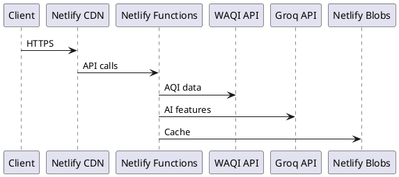

# ডেভেলপমেন্ট টুলিং
এই পৃষ্ঠায় JanVayu তৈরি এবং রক্ষণাবেক্ষণের জন্য ব্যবহৃত টুল এবং ওয়ার্কফ্লোগুলো তুলে ধরা হয়েছে — যেখানে প্রধান AI-সহায়ক ডেভেলপমেন্ট টুল হিসেবে Claude Code-এর ওপর জোর দেওয়া হয়েছে।
---
## Claude Code (Anthropic)
সফটওয়্যার ইঞ্জিনিয়ারিংয়ের জন্য অ্যানথ্রপিকের CLI এজেন্ট **Claude Code**-এর উল্লেখযোগ্য সহায়তায় JanVayu তৈরি করা হয়েছে। Claude Code নিচের কাজগুলোর জন্য ব্যবহৃত হয়েছে:
- Netlify Functions লেখা
- ফ্রন্টএন্ড তৈরি করা (`index.html`, `app.js`, `styles.css` এবং প্যানেল ফ্র্যাগমেন্টগুলো)
- gpt-oss-120b প্রম্পট ইঞ্জিনিয়ারিং (স্কিল ফাইল) তৈরি করা
- এই Docsify ডকুমেন্টেশন তৈরি করা
- Git ওয়ার্কফ্লো পরিচালনা করা (কমিট, PR, চেঞ্জলগ)
- সার্ভারলেস ফাংশনের সমস্যা ডিবাগ করা
- কোড রিভিউ এবং রিফ্যাক্টরিং
JanVayu তৈরি করতে ব্যবহৃত সম্পূর্ণ Claude Code সেটআপ, ওয়ার্কফ্লো এবং কনফিগারেশনের জন্য, ডেডিকেটেড [Claude Code বিভাগ](../claude-code/overview.md) দেখুন।
---
## এডিটর কনফিগারেশন
`.editorconfig` সব কন্ট্রিবিউটরের জন্য ফরম্যাটিং স্ট্যান্ডার্ডাইজ করে:
| ফাইলের ধরন | ইনডেন্টেশন |
|-----------|-------------|
| HTML, CSS, JS, JSON, YAML | 2 স্পেস |
| Python | 4 স্পেস |
| Makefile | ট্যাব |
সব ফাইল: UTF-8, LF লাইন এন্ডিং, ট্রেইলিং হোয়াইটস্পেস ট্রিম করা (Markdown ছাড়া)।
---
## Git ওয়ার্কফ্লো
### কমিট মেসেজ কনভেনশন
`commit-msg` হুক দ্বারা এটি প্রয়োগ করা হয়। প্রতিটি কমিট নিচের যেকোনো একটি দিয়ে শুরু হতে হবে:
```
Add:       — নতুন ফিচার বা ফাইল
Fix:       — বাগ ফিক্স
Update:    — বিদ্যমান ফিচারের উন্নতি
Translate: — নতুন বা আপডেট করা অনুবাদ
Docs:      — ডকুমেন্টেশনের পরিবর্তন
Refactor:  — কোড রিস্ট্রাকচারিং (আচরণে কোনো পরিবর্তন নেই)
Test:      — টেস্ট যোগ বা পরিবর্তন
CI:        — CI/CD পাইপলাইনের পরিবর্তন
Chore:     — রক্ষণাবেক্ষণের কাজ
Merge:     — মার্জ কমিট
```
### প্রি-কমিট চেক
`pre-commit` হুক স্বয়ংক্রিয়ভাবে:
1. `.env`, ক্রেডেনশিয়াল এবং সিক্রেট ফাইল স্টেজ করা ব্লক করে
2. `console.log` ডিবাগ স্টেটমেন্ট সম্পর্কে সতর্ক করে
3. মার্জ কনফ্লিক্ট মার্কার (`<<<<<<<`) শনাক্ত করে
4. 500 KB-এর চেয়ে বড় ফাইলের ক্ষেত্রে সতর্ক করে
### ব্রাঞ্চ স্ট্র্যাটেজি
- `main` — প্রোডাকশন (স্বয়ংক্রিয়ভাবে Netlify-তে ডিপ্লয় হয়)
- `claude/*` — Claude Code ডেভেলপমেন্ট ব্রাঞ্চ (main-এ PR)
- ফিচার ব্রাঞ্চগুলো পুল রিকোয়েস্টের মাধ্যমে মার্জ করা হয়
---
## লোকাল ডেভেলপমেন্ট
```bash
# ডিপেন্ডেন্সি ইনস্টল করুন (শুধুমাত্র সার্ভার-সাইড)
npm ci
# Netlify Functions এমুলেশন দিয়ে লোকালি রান করুন
netlify dev
```
`netlify dev` লোকালি সম্পূর্ণ Netlify এনভায়রনমেন্ট এমুলেট করে:
- `localhost:8888`-এ `index.html` সার্ভ করে
- সব Netlify Functions এমুলেট করে
- এনভায়রনমেন্ট ভেরিয়েবলের জন্য `.env` রিড করে
- Netlify Blobs সিমুলেট করে
-
অন্য কোনো সেটআপের প্রয়োজন নেই। কোনো Docker নেই, কোনো database নেই, কোনো bundler নেই (deploy করার সময় একটি version-stamp script রান করে)।
---
## Docs Stack
ডকুমেন্টেশন সাইটটি হলো `/docs/` এর একটি সিঙ্গেল-পেজ Docsify শেল, যা সরাসরি `docs/` ডিরেক্টরি থেকে markdown লোড করে। অনুবাদিত ভাষাগুলো `docs-{lang}/` এ থাকে এবং Docsify hash routes-এর মাধ্যমে রাউট করা হয় (যেমন `/docs/#/hi/`)।
| Component | কী করে |
|-----------|-------------|
| **Docsify** | ব্রাউজারে markdown-কে HTML-এ রেন্ডার করে; কোনো build step নেই |
| **docsify-themeable** | ব্র্যান্ড-রঙের থিম (JanVayu সবুজ) এবং ডার্ক মোড সহ |
| **docsify-pagination** | পেজগুলোর মধ্যে Previous/Next নেভিগেশন |
| **docsify-copy-code** | প্রতিটি code block-এ কপি বাটন |
| **Prism.js** | bash, JS, JSON, YAML, TOML, Markdown-এর জন্য সিনট্যাক্স হাইলাইটিং |
| **docsify-search, docsify-zoom-image** | পেজের ভেতরে সার্চ এবং ইমেজ জুম |
### ডায়াগ্রামের জন্য PlantUML ব্যবহার করা
Docsify নিজে থেকে সার্ভার-সাইডে PlantUML রেন্ডার করে না। আপনার যদি কোনো doc পেজে ডায়াগ্রামের প্রয়োজন হয়, তবে PlantUML CLI (বা একটি হোস্ট করা PlantUML সার্ভার) দিয়ে লোকালি PNG/SVG জেনারেট করুন এবং ইমেজটি `docs/` এ কমিট করুন। এরপর এটিকে একটি সাধারণ markdown ইমেজ হিসেবে এম্বেড করুন। PlantUML সোর্সের উদাহরণ:
````

````

---
## CI Workflows
| Workflow | Trigger | Purpose |
|----------|---------|---------|
| **CI** (`.github/workflows/ci.yml`) | `main`-এ Push/PR | সাইটের উল্লেখ করা ফিগার এবং জেনারেট করা ফাইলগুলোর রি-কম্পিউটেশন, ফাংশনগুলোর জন্য সিনট্যাক্স চেক, ইউনিট টেস্ট (`npm test`), এবং একটি অ্যাডভাইজরি Lychee লিংক চেক নিশ্চিত করে। লোকালি গেটিং চেকগুলো `bash scripts/run-ci-checks.sh` দিয়ে রান করা যায় |
| **Accessibility** (`.github/workflows/accessibility.yml`) | `main`-এ Push/PR | একটি axe অডিট (অ্যাডভাইজরি) এবং কালার-কন্ট্রাস্ট গেট |
| **CPCB daily bulletins** (`.github/workflows/cpcb-bulletins.yml`) | প্রতিদিন, 12:00 UTC | CPCB-এর বুলেটিন ফেচ করে, এটি রিড করা ফাইলগুলো রিবিল্ড করে এবং একটি পুল রিকোয়েস্ট ওপেন করে |
| **Live readings versus CPCB** (`.github/workflows/live-audit.yml`) | প্রতিদিন, 06:17 UTC | সাইটটি যেগুলোকে লাইভ রিডিং বলে, সেগুলোর সাথে ৩৩টি ট্র্যাক করা শহরের জন্য CPCB-এর বুলেটিনের তুলনা করে |
| **Translation Sync** (`.github/workflows/translations.yml`) | `main`-এ Push (docs paths) | ট্রান্সলেশন কভারেজ, SUMMARY.md প্যারিটি এবং স্টেল ট্রান্সলেশন চেক করে |
---
## Dependency Management
- **Dependabot** প্রতি মাসে npm এবং GitHub Actions-এর আপডেট চেক করে
- মেইনটেইন করার জন্য মাত্র 3টি npm প্যাকেজ রয়েছে
- CDN থেকে লোড করা লাইব্রেরিগুলো (Chart.js 4.5.1, Leaflet 1.9.4) SRI হ্যাশ সহ একদম সঠিক ভার্সনে পিন করা আছে
