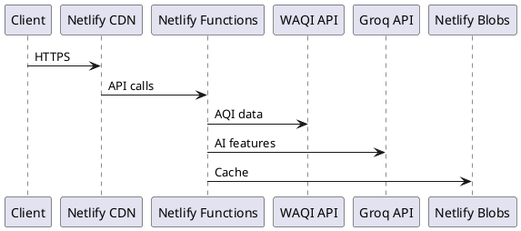

# डेवलपमेंट टूलिंग
यह पेज JanVayu को बनाने और मेंटेन करने के लिए इस्तेमाल होने वाले टूल्स और वर्कफ़्लो को कवर करता है — जिसमें मुख्य रूप से AI-असिस्टेड डेवलपमेंट टूल, Claude Code पर फोकस किया गया है।
---
## Claude Code (Anthropic)
JanVayu को **Claude Code** की काफी मदद से डेवलप किया गया था, जो सॉफ्टवेयर इंजीनियरिंग के लिए Anthropic का CLI एजेंट है। Claude Code का इस्तेमाल इन कामों के लिए किया गया:
- Netlify Functions लिखना
- फ्रंटएंड बनाना (`index.html`, `app.js`, `styles.css` और पैनल फ्रैगमेंट्स)
- gpt-oss-120b प्रॉम्प्ट इंजीनियरिंग (स्किल्स फाइल्स) तैयार करना
- यह Docsify डॉक्यूमेंटेशन बनाना
- Git वर्कफ़्लो मैनेज करना (commits, PRs, चेंजलॉग्स)
- सर्वरलेस फंक्शन इश्यूज़ को डीबग करना
- कोड रिव्यू और रिफैक्टरिंग
JanVayu बनाने के लिए इस्तेमाल किए गए पूरे Claude Code सेटअप, वर्कफ़्लो और कॉन्फ़िगरेशन के लिए, समर्पित [Claude Code सेक्शन](../claude-code/overview.md) देखें।
---
## एडिटर कॉन्फ़िगरेशन
`.editorconfig` सभी कॉन्ट्रिब्यूटर्स के बीच फ़ॉर्मेटिंग को स्टैंडर्डाइज़ करता है:
| फ़ाइल टाइप | इंडेंटेशन |
|-----------|-------------|
| HTML, CSS, JS, JSON, YAML | 2 स्पेसेस |
| Python | 4 स्पेसेस |
| Makefile | टैब्स |
सभी फ़ाइल्स: UTF-8, LF लाइन एंडिंग्स, ट्रेलिंग व्हाइटस्पेस ट्रिम करना (Markdown को छोड़कर)।
---
## Git वर्कफ़्लो
### कमिट मैसेज कन्वेंशन
इसे `commit-msg` हुक द्वारा लागू किया जाता है। हर कमिट की शुरुआत इनमें से किसी एक से होनी चाहिए:
```
Add:       — नया फीचर या फ़ाइल
Fix:       — बग फिक्स
Update:    — मौजूदा फीचर में सुधार
Translate: — नया या अपडेटेड ट्रांसलेशन
Docs:      — डॉक्यूमेंटेशन बदलाव
Refactor:  — कोड रीस्ट्रक्चरिंग (बिहेवियर में कोई बदलाव नहीं)
Test:      — टेस्ट एडिशन या बदलाव
CI:        — CI/CD पाइपलाइन बदलाव
Chore:     — मेंटेनेंस टास्क
Merge:     — मर्ज कमिट्स
```
### प्री-कमिट चेक्स
`pre-commit` हुक स्वचालित रूप से:
1. `.env`, क्रेडेंशियल्स और सीक्रेट फ़ाइलों को स्टेज होने से रोकता है
2. `console.log` डीबग स्टेटमेंट्स के बारे में चेतावनी देता है
3. मर्ज कॉन्फ्लिक्ट मार्कर्स (`<<<<<<<`) का पता लगाता है
4. 500 KB से बड़ी फ़ाइलों पर चेतावनी देता है
### ब्रांच स्ट्रेटेजी
- `main` — प्रोडक्शन (Netlify पर ऑटो-डिप्लॉय होता है)
- `claude/*` — Claude Code डेवलपमेंट ब्रांचेस (main में PR)
- फीचर ब्रांचेस पुल रिक्वेस्ट के ज़रिए मर्ज होती हैं
---
## लोकल डेवलपमेंट
```bash
# Install dependencies (server-side only)
npm ci

# Run locally with Netlify Functions emulation
netlify dev
```
`netlify dev` स्थानीय स्तर पर पूरे Netlify एनवायरनमेंट को एम्यूलेट करता है:
- `localhost:8888` पर `index.html` सर्व करता है
- सभी Netlify Functions को एम्यूलेट करता है
- एनवायरनमेंट वेरिएबल्स के लिए `.env` पढ़ता है
- Netlify Blobs को सिमुलेट करता है
-
किसी अन्य सेटअप की आवश्यकता नहीं है। कोई Docker नहीं, कोई database नहीं, कोई bundler नहीं (deploy पर एक version-stamp script चलती है)।
---
## Docs Stack

डॉक्यूमेंटेशन साइट `/docs/` पर एक सिंगल-पेज Docsify शेल है जो सीधे `docs/` डायरेक्टरी से markdown लोड करता है। अनुवादित भाषाएं `docs-{lang}/` में रहती हैं और Docsify हैश रूट्स (जैसे `/docs/#/hi/`) के माध्यम से रूट की जाती हैं।
| Component | What It Does |
|-----------|-------------|
| **Docsify** | ब्राउज़र में markdown को HTML में रेंडर करता है; कोई बिल्ड स्टेप नहीं |
| **docsify-themeable** | ब्रांड-रंग की थीम (JanVayu हरा) डार्क मोड के साथ |
| **docsify-pagination** | पेजों के बीच Previous/Next नेविगेशन |
| **docsify-copy-code** | हर कोड ब्लॉक पर कॉपी बटन |
| **Prism.js** | bash, JS, JSON, YAML, TOML, Markdown के लिए सिंटैक्स हाइलाइटिंग |
| **docsify-search, docsify-zoom-image** | इन-पेज सर्च और इमेज ज़ूम |
### डायग्राम के लिए PlantUML का उपयोग करना
Docsify खुद सर्वर-साइड पर PlantUML को रेंडर नहीं करता है। यदि आपको किसी doc पेज में डायग्राम की आवश्यकता है, तो PlantUML CLI (या होस्टेड PlantUML सर्वर) के साथ स्थानीय रूप से PNG/SVG जनरेट करें और इमेज को `docs/` में कमिट करें। फिर इसे एक नियमित markdown इमेज के रूप में एम्बेड करें। उदाहरण PlantUML सोर्स:
````

````

---
## CI Workflows
| Workflow | Trigger | Purpose |
|----------|---------|---------|
| **CI** (`.github/workflows/ci.yml`) | `main` पर पुश/PR | यह सुनिश्चित करता है कि साइट के बताए गए आंकड़े और जनरेट की गई फाइलें फिर से कैलकुलेट हों, फंक्शन्स के लिए सिंटैक्स चेक, यूनिट टेस्ट (`npm test`), और एक एडवाइजरी Lychee लिंक चेक। `bash scripts/run-ci-checks.sh` गेटिंग चेक्स को स्थानीय रूप से चलाता है |
| **Accessibility** (`.github/workflows/accessibility.yml`) | `main` पर पुश/PR | एक axe ऑडिट (एडवाइजरी) और कलर-कंट्रास्ट गेट |
| **CPCB daily bulletins** (`.github/workflows/cpcb-bulletins.yml`) | दैनिक, 12:00 UTC | CPCB का बुलेटिन लाता है, इसे पढ़ने वाली फाइलों को फिर से बनाता है और एक पुल रिक्वेस्ट खोलता है |
| **Live readings versus CPCB** (`.github/workflows/live-audit.yml`) | दैनिक, 06:17 UTC | साइट द्वारा लाइव कही जाने वाली रीडिंग की तुलना 33 ट्रैक किए गए शहरों के लिए CPCB के बुलेटिन से करता है |
| **Translation Sync** (`.github/workflows/translations.yml`) | `main` पर पुश (docs paths) | ट्रांसलेशन कवरेज, SUMMARY.md पैरिटी, और पुरानी (stale) ट्रांसलेशन की जांच करता है |
---
## Dependency Management
- **Dependabot** हर महीने npm और GitHub Actions अपडेट्स की जाँच करता है
- मेंटेन करने के लिए केवल 3 npm पैकेज हैं
- CDN-लोडेड लाइब्रेरीज़ (Chart.js 4.5.1, Leaflet 1.9.4) को सटीक वर्ज़न और SRI हैश के साथ पिन किया गया है
