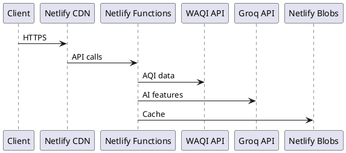

# डेव्हलपमेंट टूलिंग

या पानावर JanVayu बनवण्यासाठी आणि त्याची देखभाल करण्यासाठी वापरली जाणारी साधने आणि वर्कफ्लो दिले आहेत — ज्यामध्ये प्रामुख्याने AI-आधारित डेव्हलपमेंट टूल, Claude Code वर लक्ष केंद्रित केले आहे.
---
## Claude Code (Anthropic)
JanVayu हे **Claude Code** च्या महत्त्वपूर्ण मदतीने विकसित केले गेले आहे, जे सॉफ्टवेअर इंजिनिअरिंगसाठी Anthropic चे CLI एजंट आहे. Claude Code चा वापर खालील गोष्टींसाठी केला गेला:
- Netlify Functions लिहिणे
- फ्रंटएंड बनवणे (`index.html`, `app.js`, `styles.css` आणि पॅनेल फ्रॅगमेंट्स)
- gpt-oss-120b प्रॉम्प्ट इंजिनिअरिंग (स्किल फाइल्स) तयार करणे
- ही Docsify डॉक्युमेंटेशन तयार करणे
- Git वर्कफ्लो व्यवस्थापित करणे (commits, PRs, changelogs)
- सर्व्हरलेस फंक्शनच्या समस्या डीबग करणे
- कोड रिव्ह्यू आणि रिफॅक्टरिंग
JanVayu बनवण्यासाठी वापरलेली संपूर्ण Claude Code सेटअप, वर्कफ्लो आणि कॉन्फिगरेशन पाहण्यासाठी, स्वतंत्र [Claude Code विभाग](../claude-code/overview.md) पहा.
---
## एडिटर कॉन्फिगरेशन
`.editorconfig` सर्व योगदानकर्त्यांसाठी फॉरमॅटिंग प्रमाणित करते:
| फाइल प्रकार | इंडेंटेशन |
|-----------|-------------|
| HTML, CSS, JS, JSON, YAML | 2 स्पेसेस |
| Python | 4 स्पेसेस |
| Makefile | टॅब्स |
सर्व फाइल्स: UTF-8, LF लाईन एंडिंग्स, शेवटी असलेली व्हाईटस्पेस ट्रिम करणे (Markdown वगळून).
---
## Git वर्कफ्लो
### कमिट मेसेज कन्व्हेन्शन
हे `commit-msg` हूकद्वारे लागू केले जाते. प्रत्येक कमिट खालीलपैकी एकाने सुरू झाले पाहिजे:
```
Add:       — नवीन फीचर किंवा फाइल
Fix:       — बग फिक्स
Update:    — विद्यमान फीचरमध्ये सुधारणा
Translate: — नवीन किंवा अपडेट केलेले ट्रान्सलेशन
Docs:      — डॉक्युमेंटेशनमधील बदल
Refactor:  — कोडचे पुनर्रचना (वर्तनात बदल नाही)
Test:      — टेस्टमधील भर किंवा बदल
CI:        — CI/CD पाइपलाइनमधील बदल
Chore:     — देखभाल कार्ये
Merge:     — मर्ज कमिट्स
```
### प्री-कमिट चेक्स
`pre-commit` हूक आपोआप:
1. `.env`, क्रेडेन्शियल्स आणि सिक्रेट फाइल्स स्टेज होण्यापासून ब्लॉक करते
2. `console.log` डीबग स्टेटमेंट्सबद्दल इशारा देते
3. मर्ज कॉन्फ्लिक्ट मार्कर्स (`<<<<<<<`) शोधते
4. 500 KB पेक्षा मोठ्या फाइल्सवर इशारा देते
### ब्रांच स्ट्रॅटेजी
- `main` — प्रॉडक्शन (Netlify वर ऑटो-डिप्लॉय होते)
- `claude/*` — Claude Code डेव्हलपमेंट ब्रांचेस (main मध्ये PR)
- फीचर ब्रांचेस पुल रिक्वेस्टद्वारे मर्ज केल्या जातात
---
## लोकल डेव्हलपमेंट
```bash
# Install dependencies (server-side only)
npm ci

# Run locally with Netlify Functions emulation
netlify dev
```
`netlify dev` स्थानिक पातळीवर संपूर्ण Netlify वातावरण एमुलेट करते:
- `localhost:8888` वर `index.html` सर्व्ह करते
- सर्व Netlify Functions एमुलेट करते
- एन्व्हायर्नमेंट व्हेरिएबल्ससाठी `.env` वाचते
- Netlify Blobs सिम्युलेट करते
-
इतर कोणत्याही सेटअपची आवश्यकता नाही. Docker नाही, database नाही, bundler नाही (deploy करताना एक version-stamp script चालते).
---
## Docs Stack

डॉक्युमेंटेशन साईट ही `/docs/` वरील एक single-page Docsify shell आहे, जी `docs/` डिरेक्टरीमधून थेट markdown लोड करते. अनुवादित भाषा `docs-{lang}/` मध्ये असतात आणि त्या Docsify hash routes द्वारे (उदा. `/docs/#/hi/`) राऊट केल्या जातात.
| Component | What It Does |
|-----------|-------------|
| **Docsify** | ब्राउझरमध्ये markdown ला HTML मध्ये रेंडर करते; build step ची गरज नाही |
| **docsify-themeable** | ब्रँड-रंगाची थीम (JanVayu हिरवा) आणि dark mode |
| **docsify-pagination** | पानांमधील Previous/Next नेव्हिगेशन |
| **docsify-copy-code** | प्रत्येक code block वर Copy बटण |
| **Prism.js** | bash, JS, JSON, YAML, TOML, Markdown साठी syntax highlighting |
| **docsify-search, docsify-zoom-image** | इन-पेज सर्च आणि इमेज झूम |
### Using PlantUML for Diagrams

Docsify स्वतः server-side वर PlantUML रेंडर करत नाही. जर तुम्हाला doc पेजवर diagram ची गरज असेल, तर PlantUML CLI (किंवा होस्ट केलेले PlantUML server) वापरून स्थानिक पातळीवर PNG/SVG तयार करा आणि ती इमेज `docs/` मध्ये कमिट करा. त्यानंतर ती एक सामान्य markdown इमेज म्हणून एम्बेड करा. उदाहरण PlantUML सोर्स:
````

````

---
## CI Workflows
| Workflow | Trigger | Purpose |
|----------|---------|---------|
| **CI** (`.github/workflows/ci.yml`) | `main` वर Push/PR | साईटचे दिलेले आकडे आणि जनरेट केलेल्या फाईल्स पुन्हा कॅल्क्युलेट करणे, functions साठी syntax checks, युनिट टेस्ट्स (`npm test`), आणि एक सल्लागार Lychee लिंक चेक सुरक्षित करते. `bash scripts/run-ci-checks.sh` स्थानिक पातळीवर गेटिंग चेक चालवते |
| **Accessibility** (`.github/workflows/accessibility.yml`) | `main` वर Push/PR | एक axe ऑडिट (सल्लागार) आणि कलर-कॉन्ट्रास्ट गेट |
| **CPCB daily bulletins** (`.github/workflows/cpcb-bulletins.yml`) | दररोज, 12:00 UTC | CPCB चे बुलेटिन आणते, ते वाचणाऱ्या फाईल्स पुन्हा तयार करते आणि एक pull request उघडते |
| **Live readings versus CPCB** (`.github/workflows/live-audit.yml`) | दररोज, 06:17 UTC | साईट ज्याला live readings म्हणते त्याची तुलना 33 ट्रॅक केलेल्या शहरांसाठी CPCB च्या बुलेटिनशी करते |
| **Translation Sync** (`.github/workflows/translations.yml`) | `main` वर Push (docs paths) | ट्रान्सलेशन कव्हरेज, SUMMARY.md ची समानता आणि जुने झालेले ट्रान्सलेशन्स तपासते |
---
## Dependency Management
- **Dependabot** दर महिन्याला npm आणि GitHub Actions अपडेट्स तपासते
- देखभाल करण्यासाठी फक्त 3 npm पॅकेजेस आहेत
- CDN-लोड केलेल्या लायब्ररीज (Chart.js 4.5.1, Leaflet 1.9.4) अचूक आवृत्त्यांवर आणि SRI हॅशेससह पिन केल्या आहेत
